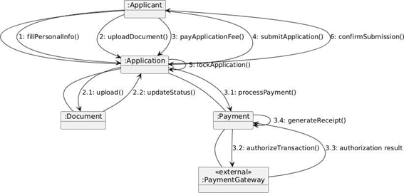
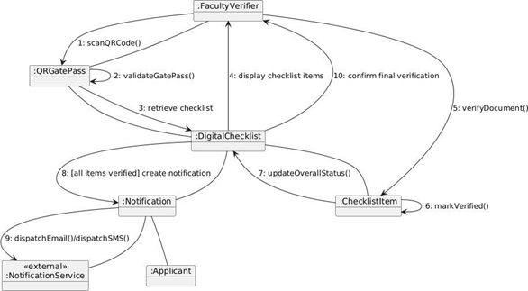
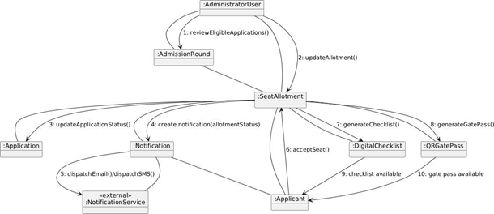

# Lab Assignment 5 – Collaboration Model (SAMS)

**Course:** CS314 Software Development Laboratory | **Team:** T001

This document models object interactions for the same three detailed use cases carried forward from Assignment 2: UC-002 (Fill and Submit Application), UC-008 (Scan QR and Verify Documents) and UC-012 (Manage Admission Rounds and Seat Allotment). Every object shown is a class from the Assignment 4 Class Diagram, and every message is a sequence-numbered operation of one of those classes.

## 1. UC-002 – Fill and Submit Application

**Objects:** :Applicant, :Application, :Document, :Payment, «external» :PaymentGateway

| Seq | Message | Sender → Receiver | Responsibility |
|---|---|---|---|
| 1 | fillPersonalInfo() | Applicant → Application | Applicant supplies personal, address and qualifying-exam details that Application captures (FR-006–FR-009). |
| 2 | uploadDocument() | Applicant → Application | Applicant asks Application to record an uploaded supporting document. |
| 2.1 | upload() | Application → Document | Application delegates storage of the file to a Document object (FR-010). |
| 2.2 | updateStatus() | Application → Document | Document verification status is set (e.g. "Uploaded") (FR-011). |
| 3 | payApplicationFee() | Applicant → Application | Applicant initiates payment of the fee. |
| 3.1 | processPayment() | Application → Payment | Application delegates fee handling to Payment (FR-013). |
| 3.2 | authorizeTransaction() | Payment → PaymentGateway | Payment requests authorization from the external gateway. |
| 3.3 | authorization result | PaymentGateway → Payment | Gateway returns success/failure. |
| 3.4 | generateReceipt() | Payment (self) | On success, Payment generates a receipt and records the status (FR-014). |
| 4 | submitApplication() | Applicant → Application | Applicant reviews and submits the application (FR-012). |
| 5 | lockApplication() | Application (self) | Application locks itself so it can no longer be edited (BR-004). |
| 6 | confirmSubmission() | Application → Applicant | Confirms successful submission to the Applicant. |

## 2. UC-008 – Scan QR and Verify Documents

**Objects:** :FacultyVerifier, :QRGatePass, :DigitalChecklist, :ChecklistItem, :Notification, «external» :NotificationService, :Applicant

| Seq | Message | Sender → Receiver | Responsibility |
|---|---|---|---|
| 1 | scanQRCode() | FacultyVerifier → QRGatePass | Verifier scans the applicant's QR-based gate pass (FR-025). |
| 2 | validateGatePass() | QRGatePass (self) | Checks its own validity status and expiry before proceeding (BR-006). |
| 3 | retrieve checklist | QRGatePass → DigitalChecklist | Once validated, the pass retrieves the applicant's checklist. |
| 4 | display checklist items | DigitalChecklist → FacultyVerifier | Returns its items so the verifier can compare against original documents. |
| 5 | verifyDocument() | FacultyVerifier → ChecklistItem | Verifier marks a checklist item as verified against the physical document (FR-026). |
| 6 | markVerified() | ChecklistItem (self) | Records verification status, verifier ID and timestamp (BR-007). |
| 7 | updateOverallStatus() | ChecklistItem → DigitalChecklist | Checklist recomputes its overall status. |
| 8 | [all items verified] create notification | DigitalChecklist → Notification | When every required item is verified, final verification is complete (BR-008) and a Notification is created (FR-027/FR-028). |
| 9 | dispatchEmail()/dispatchSMS() | Notification → NotificationService | Notification asks the external service to alert the Applicant. |
| 10 | confirm final verification | DigitalChecklist → FacultyVerifier | Confirms to the verifier that final verification is complete. |

The Notification object also informs the Applicant directly (real-time checklist update), satisfying FR-027.

## 3. UC-012 – Manage Admission Rounds and Seat Allotment

**Objects:** :AdministratorUser, :AdmissionRound, :SeatAllotment, :Application, :Notification, «external» :NotificationService, :Applicant, :DigitalChecklist, :QRGatePass

| Seq | Message | Sender → Receiver | Responsibility |
|---|---|---|---|
| 1 | reviewEligibleApplications() | AdministratorUser → AdmissionRound | Administrator asks for the applications eligible for allotment (FR-018). |
| 2 | updateAllotment() | AdministratorUser → SeatAllotment | Administrator records the allotment decision (FR-019). |
| 3 | updateApplicationStatus() | SeatAllotment → Application | Linked Application status is updated (FR-031). |
| 4 | create notification(allotmentStatus) | SeatAllotment → Notification | Notification created with the applicant's new allotment status. |
| 5 | dispatchEmail()/dispatchSMS() | Notification → NotificationService | External service alerts the Applicant (FR-033). |
| 6 | acceptSeat() | Applicant → SeatAllotment | Applicant accepts the offered seat (FR-021). |
| 7 | generateChecklist() | SeatAllotment → DigitalChecklist | Triggers generation of the personalized checklist (BR-005, FR-022). |
| 8 | generateGatePass() | SeatAllotment → QRGatePass | Triggers generation of the QR gate pass (BR-005, FR-023). |
| 9 | checklist available | DigitalChecklist → Applicant | Checklist becomes visible on the applicant's dashboard (FR-024). |
| 10 | gate pass available | QRGatePass → Applicant | Gate pass becomes available for campus entry and verification. |
