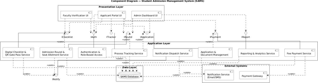

# Lab Assignment 5 – Component Model (SAMS)

**Course:** CS314 Software Development Laboratory | **Team:** T001

The diagram shows the major software components of SAMS, organized into a Presentation Layer, an Application Layer, a Data Layer and the External Systems the platform depends on. It supports all functionality of the three detailed use cases and the wider requirements in Assignment 2.

## 1. Components and Responsibilities

- **Presentation Layer** – Faculty Verification UI, Applicant Portal UI and Admin Dashboard UI: the three role-specific front ends from the User Classes.
- **Digital Checklist & QR Gate Pass Service** – FR-022–FR-024 (checklist generation/status) and FR-023 (gate pass); exposed through `IChecklist`, used by the Faculty Verification UI and Applicant Portal UI.
- **Admission Round & Seat Allotment Service** – FR-018–FR-021; exposed through `IRound`, used by the Admin Dashboard UI and Applicant Portal UI.
- **Authentication & Role-Based Access** – FR-001–FR-005; exposed through `IAuth`, used by every presentation component.
- **Process Tracking Service** – FR-016–FR-017; exposed through `ITracker` for the Applicant Portal UI.
- **Application & Document Management** – FR-006–FR-012; exposed through `IApplication`.
- **Notification Dispatch Service** – FR-033; exposed through `INotify`; used by the Checklist/QR Service, the Allotment Service and Application & Document Management, and itself uses the external Notification Service (Email/SMS).
- **Fee Payment Service** – FR-013–FR-015; exposed through `IPayment`; uses the external Payment Gateway.
- **Reporting & Analytics Service** – FR-032; exposed through `IReport` for the Admin Dashboard UI.
- **SAMS Database (Data Layer)** – shared persistence store used («uses») by every Application Layer component for Applicant, Application, Document, Payment, AdmissionRound, SeatAllotment, DigitalChecklist, ChecklistItem, QRGatePass and Notification records.
- **External Systems** – Notification Service (Email/SMS) and Payment Gateway, reached only through the Notification Dispatch Service and Fee Payment Service respectively.

## 2. Dependencies

- Each Presentation Layer UI depends («uses», dashed arrows) on the interfaces of the services it needs – e.g. the Faculty Verification UI depends on `IChecklist`; the Admin Dashboard UI depends on `IRound`, `IApplication`, `IReport` and `IPayment`.
- Application Layer components depend on the SAMS Database through the Data Layer; Notification Dispatch Service and Fee Payment Service depend on their respective External Systems.
- The Checklist/QR Service and the Allotment Service both depend on the Notification Dispatch Service (`INotify`), matching the generateChecklist()/generateGatePass()/create-notification messages in the Collaboration Model.

## 3. Consistency Check

The models maintain the traceability chain: Assignment 2 Requirements → 3 Detailed Use Cases (UC-002, UC-008, UC-012) → Assignment 3 Scenarios/Activity Diagrams → Assignment 4 Classes/Object Diagram/Relationships → Collaboration Diagrams → State Diagrams → Component Diagram. Every object and message corresponds to a class and operation in the Assignment 4 Class Diagram, every state transition to a business rule or functional requirement in the SRS, and every component to functionality already described in the use cases. No new functionality has been introduced beyond the SRS.

## 4. Individual Contribution

- Student 1 (Aryan Singh, 24DCS002): Collaboration Diagram and message table for UC-002; reviewed consistency with Assignments 2–4.
- Student 2 (Bhumika Bhardwaj, 24DCS005): Collaboration Diagram and message table for UC-012; contributed to component dependency analysis.
- Student 3 (Pradyuman Gupta, 24DCS006): Collaboration Diagram and message table for UC-008; State Diagram for DigitalChecklist.
- Student 4 (Bhavya Watts, 23UCS556): State Diagram for Application; Component Diagram and its descriptions; compiled the final document.

## 5. AI Usage Policy – Student Declaration

AI tools may be used as supporting tools. The team is responsible for the correctness, consistency and understanding of all submitted collaboration, state and component models.

- We have disclosed the use of AI tools, if any.
- AI-generated suggestions have been reviewed, verified and adapted by the team.
- We understand and can explain the submitted collaboration, state and component diagrams.
- We have verified that the UML models are consistent with our project's requirements, use cases, classes, objects and scope.
- The final submission represents our team's understanding and modeling decisions.

**AI Tool(s) Used:** ChatGPT
**Purpose of AI Use:** Used to help structure the collaboration, state and component models consistent with the Assignment 2 SRS and the Assignment 3–4 UML models.
**Team ID:** T001
**Team Representative:** PRADYUMAN GUPTA
**Date:** 27-09-2026

*We confirm that the collaboration diagrams, state diagrams and component diagram presented reflect our own understanding of the SAMS project, and that we accept responsibility for the submitted work.*

**Team Representative Signature/Confirmation:** PRADYUMAN GUPTA
