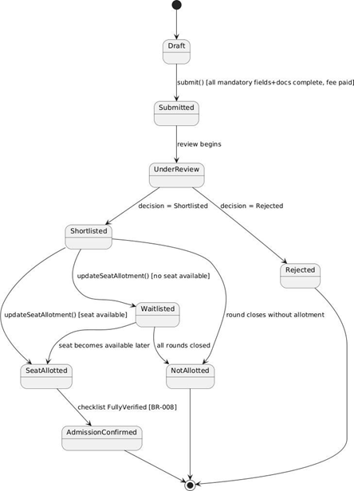
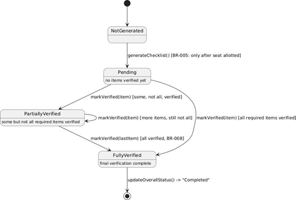

# Lab Assignment 5 – State Model (SAMS)

**Course:** CS314 Software Development Laboratory | **Team:** T001

Two objects whose state changes materially across the three use cases were selected: **Application** (spans UC-002 and UC-012) and **DigitalChecklist** (spans UC-012 and UC-008).

## 1. State Diagram – Application

| Element | Detail |
|---|---|
| Initial state | Draft – created when the applicant begins the application (UC-002). |
| Intermediate states | Submitted; UnderReview; Shortlisted; Waitlisted; SeatAllotted. |
| Events / Transitions | submit() [all mandatory fields+docs complete, fee paid]: Draft → Submitted; review begins: Submitted → UnderReview; decision = Shortlisted: UnderReview → Shortlisted; decision = Rejected: UnderReview → Rejected; updateSeatAllotment() [seat available]: Shortlisted → SeatAllotted; updateSeatAllotment() [no seat available]: Shortlisted → Waitlisted; seat becomes available later: Waitlisted → SeatAllotted; all rounds closed: Waitlisted → NotAllotted; round closes without allotment: Shortlisted → NotAllotted; checklist FullyVerified [BR-008]: SeatAllotted → AdmissionConfirmed. |
| Guards / conditions | [all mandatory fields+docs complete, fee paid] on submit() (BR-002, BR-003); [seat available] / [no seat available] on updateSeatAllotment(); [BR-008] on the SeatAllotted → AdmissionConfirmed transition. |
| Final states | AdmissionConfirmed and Rejected/NotAllotted both terminate at the final state, reflecting the two possible outcomes of the admission lifecycle. |

## 2. State Diagram – DigitalChecklist

| Element | Detail |
|---|---|
| Initial state | NotGenerated – before a seat has been allotted. |
| Intermediate states | Pending (no items verified yet); PartiallyVerified (some but not all required items verified). |
| Events / Transitions | generateChecklist() [BR-005: only after seat allotted]: NotGenerated → Pending; markVerified(item) [some, not all, verified]: Pending → PartiallyVerified; markVerified(item) [more items, still not all]: PartiallyVerified → PartiallyVerified (self-transition); markVerified(item) [all required items verified]: Pending → FullyVerified; markVerified(lastItem) [all verified, BR-008]: PartiallyVerified → FullyVerified; updateOverallStatus() → "Completed": FullyVerified → final state. |
| Guards / conditions | [BR-005] guards checklist generation; [some, not all, verified] / [all required items verified] / [BR-008] guard the transitions out of Pending and PartiallyVerified. |
| Final state | Reached once updateOverallStatus() reports "Completed" (FR-024), enabling final-verification confirmation in UC-008. |
