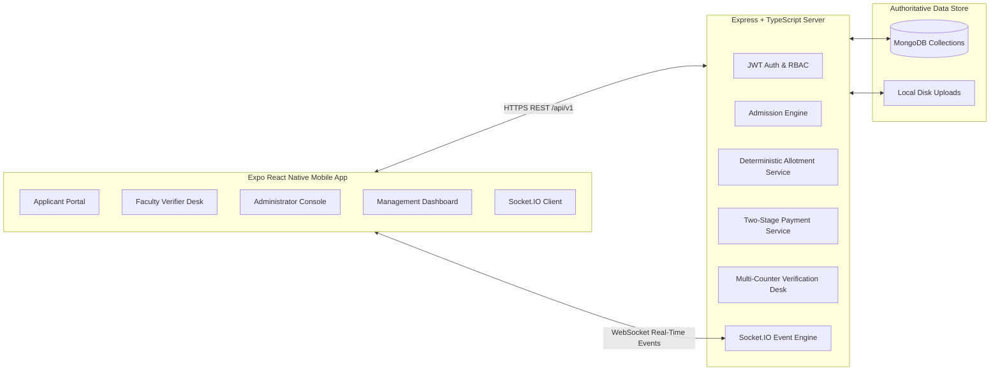

# SAMS — Student Admission Management System

Integrated, production-grade mobile admission application built for **LNM Institute of Information Technology (LNMIIT), Jaipur**. Applicants, faculty document verifiers, administrators, and institute management share a unified Expo mobile application; the authoritative Express backend enforces strict Role-Based Access Control (RBAC).

This repository is structured as an npm workspaces monorepo: `mobile/`, `server/`, `shared/`, `Documentation/`.

---

## 1. Core Architecture



---

## 2. Key Business Modules & Approved Features

### A. Four Distinct Role Experiences
1. **Applicant**:
   - Account registration & instant console OTP verification.
   - Form entry: Personal information, address, Class 10/12 qualifications, ranked branch preferences.
   - Mandatory document uploads.
   - **Payment Stage 1**: Application submission fee (₹1,000) with independent receipt (`RCP-APP-...`).
   - Submission and strict locking.
   - Live admission tracker and chronological round-by-round history.
   - Seat decision: Accept, Opt for Next Round (Float), Decline.
   - **Payment Stage 2**: Full tuition deposit dynamically calculated from allotted programme fee.
   - Personalized Digital Checklist and reusable QR Gate Pass.
2. **Faculty / Verifier**:
   - Secure counter login with assigned counter validation.
   - **Live device-camera QR scanning** (`expo-camera`) with viewfinder reticle overlay and manual entry fallback.
   - Multi-counter reusability (gate pass remains `Valid` across all counters).
   - Counter-level item authorization: Verifiers can only verify documents assigned to their desk.
   - Item-by-item verification with remarks and auto-confirmation of admission (`AdmissionConfirmed`).
   - Verification history log.
3. **Administrator**:
   - Admission cycle, programme, and round management.
   - Candidate registry with filtering, merit ranking, and eligibility management.
   - **Deterministic system-assisted seat allotment** respecting merit rank ascending, tie-breaking by submission time, preference order, and strict capacity limits.
   - Review proposed results and publish rounds (starts response window and triggers Socket.IO notifications).
   - Real-time round statistics breakdown.
4. **Institute Management (Strictly Read-Only)**:
   - Executive admission funnel metrics.
   - Programme-wise seat matrix: Approved capacity, allotted, accepted, confirmed, and vacant seats.
   - Fee collections: Application fee and tuition fee breakdowns with total realized revenue.
   - Campus verification throughput and physical counter deployment.

---

## 3. Two Distinct Payment Stages

The system strictly enforces two separate payment stages:
- **Payment Stage 1: Application Submission Fee**:
  - Fixed at ₹1,000.
  - Required before final application submission & locking.
  - Generates receipt `RCP-APP-YYYY-######`.
  - Idempotent; records `PaymentType.APPLICATION_FEE`.
- **Payment Stage 2: Full Tuition Deposit**:
  - Occurs **only after** an applicant accepts an allotted seat in a published round.
  - Dynamically fetched from the allotted programme's fee structure (CSE: ₹1.6L, CCE: ₹1.5L, ECE: ₹1.4L).
  - Generates receipt `REC-TUI-YYYY-######`.
  - Automatically generates the candidate's QR Gate Pass and Digital Checklist upon successful payment.

---

## 4. Demonstration Seed Configuration (12 Seats & 11 Candidates)

The system seeds with **12 baseline demonstration seats** across 3 engineering branches:
- **Computer Science and Engineering (CSE)**: 6 Seats (Fee: ₹1,60,000)
- **Communication and Computer Engineering (CCE)**: 4 Seats (Fee: ₹1,50,000)
- **Electronics and Communication Engineering (ECE)**: 2 Seats (Fee: ₹1,40,000)

### Seed Demonstration Accounts (`Password@123` for all)
| Email | Role / State | Key Attribute |
| --- | --- | --- |
| `admin@lnmiit.ac.in` | Administrator | Full management & allotment console |
| `faculty1@lnmiit.ac.in` | Faculty Verifier | Assigned to Counter 1 (Academic & Identity) |
| `faculty2@lnmiit.ac.in` | Faculty Verifier | Assigned to Counter 2 (Category & Affidavits) |
| `director@lnmiit.ac.in` | Institute Management | Strictly read-only overview |
| `applicant1@sams.test` | Applicant | Draft application (in progress) |
| `applicant2@sams.test` | Applicant | Paid application fee (₹1,000) & submitted |
| `applicant3@sams.test` | Applicant | Under Review (Rank: 105) |
| `applicant4@sams.test` | Applicant | Allotted CSE (Pending response) |
| `applicant5@sams.test` | Applicant | Opted Next Round / Float (Round 1 history preserved) |
| `applicant6@sams.test` | Applicant | Declined allotment (Stage: Withdrawn) |
| `applicant7@sams.test` | Applicant | Waitlisted for CSE |
| `applicant8@sams.test` | Applicant | Accepted CCE, Paid Tuition (₹1.5L), Pass: `PASS-1008` |
| `applicant9@sams.test` | Applicant | Partially Verified at Counter 1, Pass: `PASS-1009` |
| `applicant10@sams.test` | Applicant | Fully Verified & Confirmed Admission, Pass: `PASS-1010` |
| `applicant11@sams.test` | Applicant | Unverified Account (Dev OTP: `123456`) |

---

## 5. Automated Tests & Quality Assurance

All test suites run in-memory via Jest and MongoMemoryServer:

```bash
# Run tests across shared domain and server
npm run test --workspaces --if-present

# Typecheck all workspaces (TypeScript strict mode)
npm run typecheck
```

**Test Coverage Summary**:
- **10 test suites passed** (2 in `@sams/shared`, 8 in `@sams/server`)
- **50 / 50 unit and integration tests passing**
- **0 TypeScript compilation errors** across `shared`, `server`, and `mobile`.

---

## 6. Running the Application

### 1. Database & Seeding
```bash
# Seed the 12 seats, 11 candidate states, and verification desks
npm run seed -w server
```

### 2. Start Express Backend & Socket.IO Engine
```bash
npm run dev -w server
```
Server starts on `http://localhost:4000` (`/api/v1` and WebSocket engine).

### 3. Start Expo Mobile Application
```bash
npm run start -w mobile
```
Press `w` to open in web browser or scan the QR code using the Expo Go mobile app.
