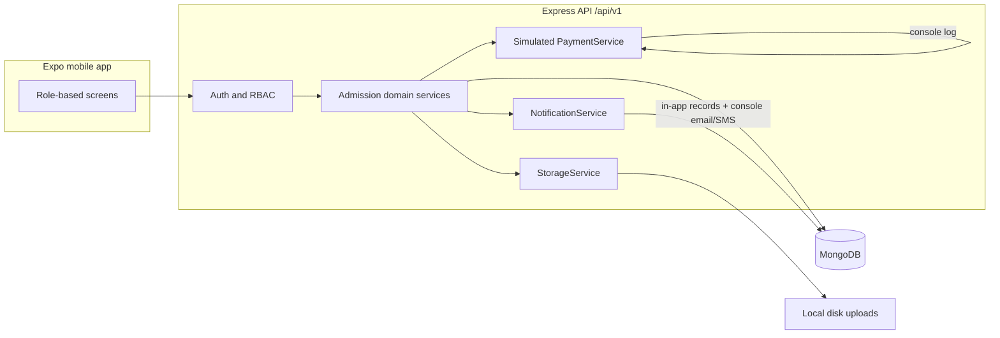

# SAMS — Student Admission Management System

Mobile-only admission app for **LNM Institute of Information Technology, Jaipur**. Applicants, administrators, faculty verifiers, and institute management share one Expo app; the API assigns and enforces roles.

This repository is an npm workspaces monorepo: `mobile/`, `server/`, `shared/`, `docs/`.

## Architecture



Simulated payment and email/SMS adapters log to the server console so the product runs with **no Cloudinary, SMS, or payment credentials**. Swap adapters behind the same interfaces for production.

## Roles

| Role | Access |
| --- | --- |
| Applicant | Own application, allotment responses, payment, checklist, QR pass |
| AdministratorUser | Rounds, allotment, eligibility, reports, audited overrides |
| FacultyVerifier | Assigned-counter QR scan and per-item verification |
| Management | Read-only statistics |

The client must not be trusted to assert a role. See `docs/SPEC.md`.

## Status (Phase 0)

Scaffold only: workspaces, TypeScript, ESLint, env examples, and documentation. Domain features start in Phase 1.

## Prerequisites

- Node.js **22.13+** (Expo SDK 58)
- npm 10+
- MongoDB local (`mongod`) or Docker for development; Atlas free tier for production
- Expo Go (SDK 58) on a phone, or an emulator

## Setup

```bash
git clone <this-repo>
cd SAMS
cp server/.env.example server/.env
cp mobile/.env.example mobile/.env
npm install
```

Set `MONGODB_URI` and a long `JWT_SECRET` in `server/.env`. Never commit `.env` files.

### MongoDB

- Local: `mongodb://127.0.0.1:27017/sams`
- Docker: `docker run -d --name sams-mongo -p 27017:27017 mongo:7`
- Atlas: use the connection string in `MONGODB_URI`

### Reach the API from a phone

Expo Go cannot call `localhost` on the device. Use:

- LAN: `EXPO_PUBLIC_API_URL=http://<your-lan-ip>:4000/api/v1` (same Wi-Fi; allow the firewall)
- Tunnel: ngrok or similar to the API port
- Deployed API HTTPS URL

## Commands

| Command | What it does |
| --- | --- |
| `npm run typecheck` | TypeScript across workspaces |
| `npm run lint` | ESLint across workspaces |
| `npm test` | Jest (shared + server; mobile passWithNoTests until UI tests exist) |
| `npm run seed` | Development seed (implemented in Phase 1) |
| `npm run server` | API (`tsx` watch in development) |
| `npm run mobile` | Expo start |

Demo accounts (after seed, **local only**, password `Password@123`): `applicant1@sams.test` … `applicant8@sams.test`, `admin@sams.test`, `faculty1@sams.test`, `faculty2@sams.test`, `management@sams.test`.

## Documentation

- `docs/SPEC.md` — workflow, statuses, business rules
- `docs/ALLOTMENT.md` — deterministic allotment
- `docs/REQUIREMENT_CHANGES.md` — vs lab assignments 1–5
- `docs/MANUAL_TEST.md` and `docs/TRACEABILITY.md` — filled in later phases

## Known limitations (Phase 0)

- No running API or screens yet
- Seed, auth, and domain tests land in Phase 1+
- Email/SMS and payment are simulated by design
- Category quota in allotment is a documented stretch goal
