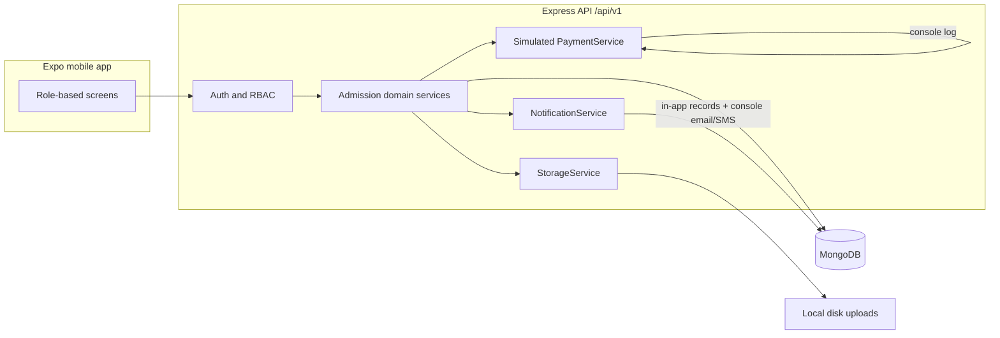

# SAMS — Student Admission Management System

Mobile-only admission app for **LNM Institute of Information Technology, Jaipur**. Applicants, administrators, faculty verifiers, and institute management share one Expo app; the API assigns and enforces roles.

This repository is an npm workspaces monorepo: `mobile/`, `server/`, `shared/`, `docs/`.

## Architecture



Simulated payment and email/SMS adapters log to the server console so the product runs with **no Cloudinary, SMS, or payment credentials**. Swap adapters behind the same interfaces for production.

## Roles

| Role | Access |
| --- | --- |
| Applicant | Own application, allotment responses, payment, checklist, QR pass |
| AdministratorUser | Rounds, allotment, eligibility, reports, audited overrides |
| FacultyVerifier | Assigned-counter QR scan and per-item verification |
| Management | Read-only statistics |

The client must not be trusted to assert a role. See `docs/SPEC.md`.

## Status: Completed End-to-End Demo Prototype (Phases 0 - 5)

Complete working presentation prototype demonstrating the full LNMIIT student admission lifecycle:
- **Phase 0 & 1:** Shared domain models, RBAC, JWT auth, MongoDB schemas, and role shells.
- **Phase 2:** Form draft & submission (locked on submit, local document uploads, progress tracker).
- **Phase 3:** Admission rounds, seat matrix configuration, deterministic merit-order allotment algorithm, and applicant accept/decline.
- **Phase 4:** Simulated fee payment gateway, automated digital checklist and QR gate pass token generation, faculty counter verification interface with item-by-item status updates, and final admission confirmation.
- **Phase 5:** Pre-seeded demo state (8 applicants across stages), executive read-only management dashboard, and demo presentation script.

## Quick Start & Demo Execution

1. Start MongoDB: Ensure MongoDB is running locally on port 27017 or configure `MONGODB_URI` in `server/.env`.
2. Seed the database with demo accounts & states:
   ```bash
   npm run seed
   ```
3. Start the API server:
   ```bash
   npm run server
   ```
4. In a separate terminal, launch the Expo mobile app:
   ```bash
   npm run mobile
   ```

See [`docs/DEMO_SCRIPT.md`](docs/DEMO_SCRIPT.md) for the exact step-by-step presentation walkthrough and demo accounts.

